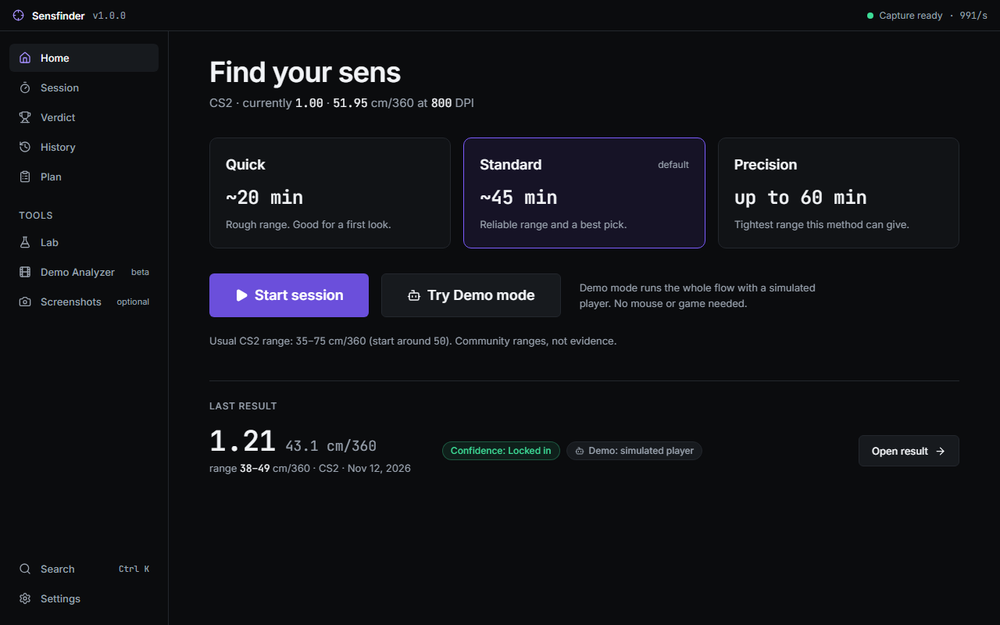
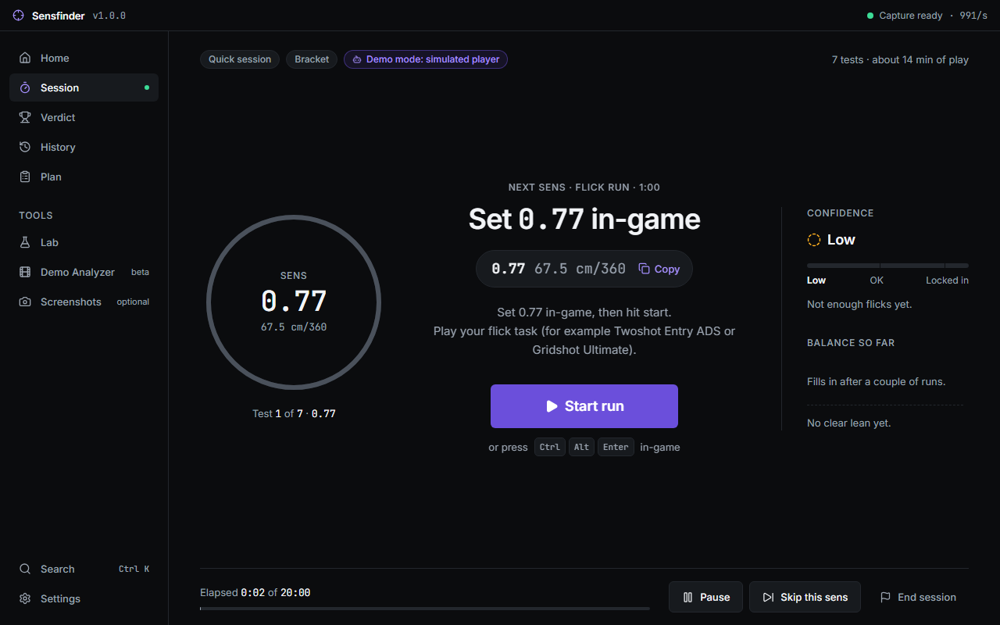
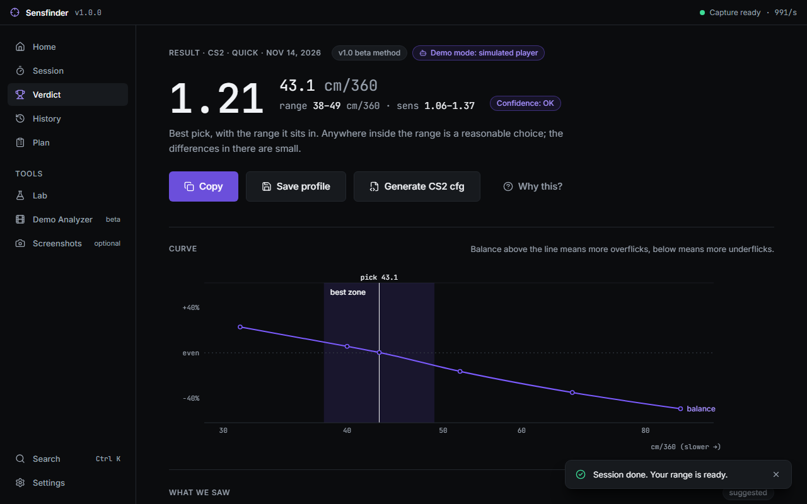
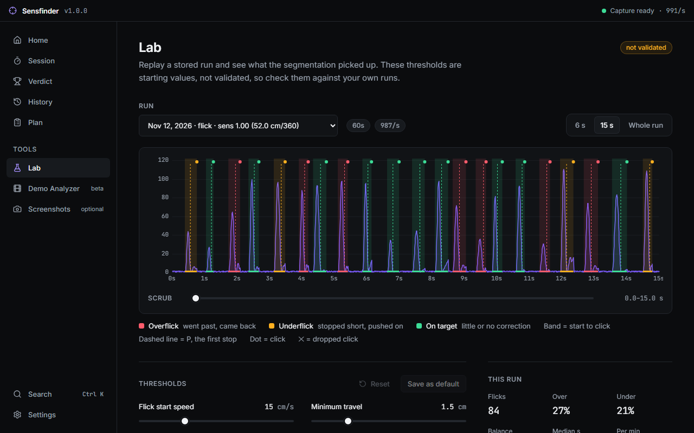
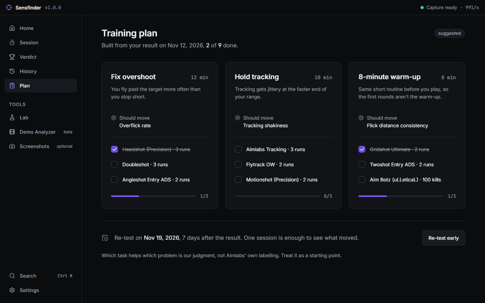

# Sensfinder

Finds a mouse sensitivity range that suits you in under an hour, then suggests what to train.
It measures every flick, not every run: while you play a 60-second task it listens to your mouse, reads
whether each flick overshot or stopped short, and looks for the sens where the two balance.

Windows 11. Local only. v1.0 uses the "v1.0 beta method": the thresholds are starting values and nothing
has been validated on people yet. Read [docs/METHOD.md](docs/METHOD.md) before trusting a number.



## Quick start

1. Download the latest `Sensfinder-<version>-setup.exe` (or the portable zip) from the repo's
   [Releases page](https://github.com/issacguerrero67-web/sensfinder/releases/latest). Don't use 1.0.0: it
   freezes on "Starting up." and never loads.
2. Check it: `Get-FileHash .\Sensfinder-1.0.1-setup.exe -Algorithm SHA256` must match `SHA256SUMS.txt`
   from the same release.
3. Run it. The build is unsigned, so Windows SmartScreen says "Windows protected your PC".
   Click **More info**, then **Run anyway**.
4. First run: pick your game, confirm your DPI, enter your current sens, do the 5-second capture test.
5. Want to see the whole flow first? On Home press **Try Demo mode**. A simulated player runs a full
   session in about two minutes. No mouse or game needed.
6. For a real session: pick **Standard**, press **Start session**, and open Aim Lab.
7. Each step tells you one thing to do: set the sens it shows, start the run, play for 60 seconds.
   `Ctrl+Alt+Enter` starts and stops a run from inside the game.
8. One run per sens. It only asks for another at the same sens when the data was too noisy to use.
9. At the end you get a best pick, a recommended range, a confidence label and a training plan.
10. Do the three checks in [docs/FIRST_RUN_CHECKS.md](docs/FIRST_RUN_CHECKS.md) before your first real session.

Portable zip: unzip anywhere and run `Sensfinder\Sensfinder.exe`.

## What you get

| | |
|---|---|
|  |  |
| Session Coach: one action per screen | Verdict: a pick and a range, never one "perfect" number |
|  |  |
| Lab: see and tune how flicks are detected | Training plan from what the session saw |

- **Tiers:** Quick (~20 min), Standard (~45 min), Precision (up to 60 min). The budget is enforced and no
  session runs past 60:00.
- **Games:** CS2 (verified conversion: 1.00 at 800 DPI = 51.95 cm/360). Marvel Rivals after a one-time
  calibration turn, because its yaw constant is not verified.
- **Also:** CS2 cfg generator, history and profiles, a CS2 Demo Analyzer (beta), an optional screenshot
  reader for Aim Lab results, and "Import beta data" for runs from the old Streamlit beta.

## Safety stance

Sensfinder is a separate program that listens to your mouse through Windows Raw Input. That is all.

- No memory reading, no DLL injection, no hooks into the game or its graphics, no overlay, no input sent
  to the game, no keyboard or mouse hooks. Hotkeys use `RegisterHotKey`.
- Mouse movement and left clicks only. No keystrokes, no window titles, no screen capture.
- It never writes game files. It shows the value with a Copy button; for CS2 it writes
  `sensfinder_sens.cfg` to its own folder for you to copy and `exec sensfinder_sens` yourself.
- No telemetry. No network calls except the manual "Check for updates", which opens the Releases page in
  your browser. Logs and runs stay on your PC, in `%LOCALAPPDATA%\Sensfinder\data`.

This design is the lowest-risk one the research found. It is **not** a clearance from any publisher.
The Aim Lab ToS could not be read during research, and Valve's and NetEase's positions on mouse
listeners are inferred, not official. Marvel Rivals is the strictest: NetEase is strict about
third-party tools, so use it at your own risk there. See [docs/COMPLIANCE_TODO.md](docs/COMPLIANCE_TODO.md).

## For testers

This is a private repo. Release downloads only work for invited collaborators who are signed in to
GitHub; anonymous links will not work. The owner invites a tester with:

```powershell
gh api -X PUT repos/issacguerrero67-web/sensfinder/collaborators/<username>
```

Found a problem? See [CONTRIBUTING.md](CONTRIBUTING.md): Settings > Export diagnostics, then open a bug report.

## Build from source

```powershell
py -3.12 -m venv .venv
.venv\Scripts\pip install -e ".[dev]"
cd ui; npm ci; npm run build; cd ..
.venv\Scripts\python -m pytest            # engine tests
.venv\Scripts\python shell\main.py        # run the app
powershell -File packaging\build.ps1      # exe + portable zip + installer + SHA256SUMS.txt
```

Layout: `engine/` (Python: capture, analysis, session, API), `ui/` (React), `shell/` (pywebview window and
tray), `packaging/`, `docs/`, `legacy/` (the beta, unmodified), `kit/` (the v1.0 spec and research).

## Docs

- [METHOD.md](docs/METHOD.md): how the estimate works, simulator results, known weaknesses
- [FIRST_RUN_CHECKS.md](docs/FIRST_RUN_CHECKS.md): three checks to do on your own hardware first
- [COMPLIANCE_TODO.md](docs/COMPLIANCE_TODO.md): what is not verified and is yours to check
- [DECISIONS.md](docs/DECISIONS.md): choices made during the build
- [API.md](docs/API.md): the engine/UI contract

## v1.1 ideas

- **Live vision:** reading the results screen as it appears. Needs an experimental toggle and a clear
  GPU-contention warning, since a local vision model and a game compete for the same 12 GB.
- **Clip analysis between rounds:** a few sampled frames after a round, as coaching hints only.
- **Per-hero auto-tuning for Marvel Rivals.**
- **Auto-update** (a private repo needs a token for release assets) and code signing.
- **Tauri shell** in place of pywebview. The UI already talks only to `http://127.0.0.1:<port>`.
- **Resume a session after a restart.**

## Licence

All rights reserved. Invited testers may use it but not redistribute it. See [LICENSE](LICENSE).
